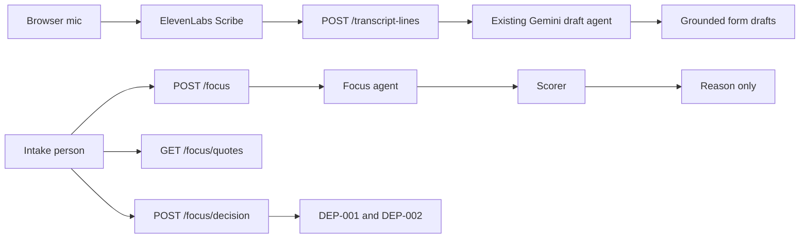
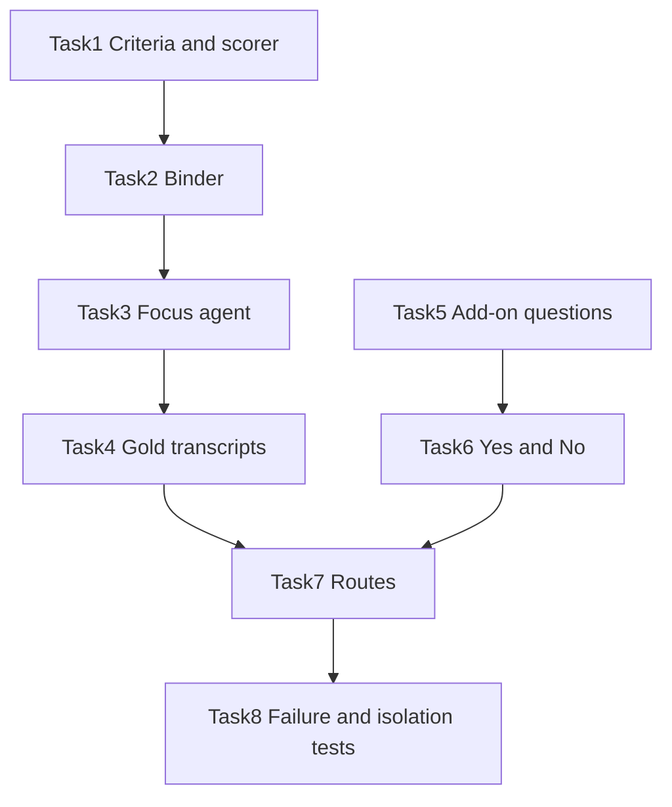

# Implementation Plan: Depression focus agent

## Overview

The intake person can be offered one possible focus, depression, a few times during a live session. The offer is one sentence. Quotes stay on a separate request. Yes opens two add-on questions the adult intake does not already ask: a prior episode, and a brief elevated-mood screen. No leaves the base form alone. Neither answer writes a diagnosis code.

This is a second agent, with its own prompt, its own in-flight flag, and its own route. It does not run inside `POST /api/sessions/:sessionId/transcript-lines`. Audio still goes from the browser to ElevenLabs. This server still never sees PCM, and this agent adds no bytes to that socket.

The plan does not promise a production deploy with zero bugs. It promises a backend whose failures leave the intake usable: empty focus, stored transcript, unchanged handoff gate, and no diagnosis line on the PDF.

## Architecture decisions

- **The model does not name the focus.** It may return `{ criterionId, evidence, t }` rows. `server/focus/score.js` turns bound ids into `depression` or nothing, and it picks the reason from fixed sentences in that file.
- **Quotes use the rule `ground` already enforces.** A quote must be a substring of the stored transcript (`...` splits into parts the same way). An unknown criterion id is dropped. If nothing required remains, the focus is absent.
- **Depression evidence is original rules, not DSM-5 prose.** Three ids: `dep-mood`, `dep-interest`, `dep-span`. The focus surfaces only when `dep-mood` and `dep-interest` are both bound. `dep-span` changes the reason sentence and is not required. The wording of those rules lives in `server/focus/criteria.js` and must not copy criteria text from the manual.
- **The form agent stays on the hot path.** `server/gemini.js` and `appendTranscriptLine` in `server/session.js` stay as they are. Focus has `record.focusing`, which is a different flag from `record.drafting`. A slow focus call cannot delay a committed line’s drafts.
- **Few model calls.** `POST .../focus` runs the model only when at least four new committed lines have arrived since the last focus call, the session has not already decided, and no focus call is in flight. `shortcut: at most one focus model call per 4 new committed lines.` A call that arrives during a flight waits for that flight and does not start another. `thinkingLevel` stays `low` on `gemini-3.8-flash`. No tool loop and no retry.
- **Yes and No are local.** `POST .../focus/decision` never calls the model. Yes returns the add-on. No hides depression for the rest of that session, including if later lines would have scored it again. A second identical decision returns the same body.
- **Quotes are opt-in.** `GET .../focus/quotes` returns them. The focus POST body has the reason and not the quotes. A No, or a session with nothing surfaced, returns `{ quotes: [] }`.
- **The add-on is not part of the canonical template.** Questions `DEP-001` and `DEP-002` live in `server/focus/addon.js`. They are not added to `server/template.js` or `src/api/templates/adultIntake.js`. `required` is false. `handoffReasons` keeps reading the template, so opening the add-on does not add a required field and does not change the 45:00 gate.
- **The PDF line stays.** `server/pdf.js` is not edited. The sentence “No diagnosis code has been assigned by this document.” stays.
- **Same PHI gate as drafts.** `synthetic: false` without `ALLOW_PHI=1` returns `{ focuses: [], code: "PHI_REFUSED" }` and does not fetch. A Gemini failure returns `{ focuses: [], code }` and does not retry. The transcript line is already stored by the other route.
- **Memory matches the rest of the session.** Focus state sits on the in-memory session record. A process restart drops it, which is already true for answers and the transcript. This plan does not write the focus or the transcript to Tiger.
- **Backend only.** No workspace panel in this plan. The API is what a later screen will call. Real users will not see the offer until that screen exists.

## Frozen contract

Both people code against these exports. Neither person renames them during the parallel work.

| Export | File | Owner |
| --- | --- | --- |
| `DEPRESSION_CRITERIA`, `DEPRESSION_ID` | `server/focus/criteria.js` | Person 1 |
| `scoreFocus(bindings)` → `null` or `{ id: "depression", reason }` | `server/focus/score.js` | Person 1 |
| `bindCriteria(candidates, transcriptLines, criterionIds)` | `server/focus/bind.js` | Person 1 |
| `suggestBindings(lines, criteria, options)` | `server/focus/agent.js` | Person 1 |
| `depressionAddon`, `addonFor(focusId)` | `server/focus/addon.js` | Person 2 |
| `applyFocusDecision(state, { focusId, decision })` | `server/focus/decision.js` | Person 2 |

`suggestBindings` returns `{ bindings: [{ criterionId, evidence, t }] }`. It does not return a focus name. `options.fetch` is injected in tests. `options.synthetic === false` observes `ALLOW_PHI`.

`applyFocusDecision` is pure. It does not read the session map. Yes sets `addon` from `addonFor`. No sets `decision: "no"` and `addon: []`. An unknown `focusId` or a decision other than `yes` or `no` throws a coded error the route will turn into 400.

## Route contract

Bearer auth stays the check already in `server/index.js`. Unknown session is 404 `{ message, code: "NOT_FOUND" }`.

- `POST /api/sessions/:sessionId/focus` → `{ seq, skipped, focuses, decision, addon }`. `focuses` is `[]` or `[{ id: "depression", reason }]`. `addon` is `[]` until Yes. `skipped: true` means the line gap was not met and the model was not called.
- `GET /api/sessions/:sessionId/focus/quotes` → `{ quotes: [{ criterionId, quote, t }] }`.
- `POST /api/sessions/:sessionId/focus/decision` with `{ focusId: "depression", decision: "yes" | "no" }` → the same shape as the focus POST, with `skipped: true` and no fetch.

`POST /api/sessions/:sessionId/transcript-lines` keeps today’s body: `{ t, speaker, text, seq, drafts }` and an optional `code`. This work adds no field to it.

## Who does what

Person 1 and Person 2 can start together. They do not edit the same files. The only existing file this plan changes is `server/index.js`, and only Person 1 changes it, after Person 2’s exports exist.

| Path | Person |
| --- | --- |
| `server/focus/criteria.js`, `score.js`, `bind.js`, `agent.js` | 1 |
| `server/test/focus-score.test.js`, `focus-bind.test.js`, `focus-agent.test.js` | 1 |
| `server/fixtures/focus-positive.json`, `focus-negative.json`, `focus-bindings.json` | 1 |
| `server/focus/addon.js`, `decision.js` | 2 |
| `server/test/focus-addon.test.js`, `focus-decision.test.js` | 2 |
| `server/focus/routes.js`, one hook in `server/index.js`, `server/test/focus-routes.test.js` | 1, after Tasks 1–6 |

Neither person edits `server/session.js`, `server/gemini.js`, `server/template.js`, `server/pdf.js`, `server/handoff.js`, `package.json`, or anything under `src/`. Routes call `findSession` and hang state on `record.focus`.

## Dependency graph

Tasks 1–4 and Tasks 5–6 have no shared files, so the two people work at the same time. Task 7 waits for both.

## Task list

### Phase 1: Person 1, the agent

- [x] Task 1: Depression criteria and scorer
- [x] Task 2: Quote binder
- [x] Task 3: Focus agent request
- [x] Task 4: Gold transcripts

### Checkpoint: Agent

- [x] Focus unit tests pass with no network
- [x] Person 2 has not been blocked

### Phase 2: Person 2, the add-on

- [x] Task 5: Depression add-on questions
- [x] Task 6: Yes and No state

### Checkpoint: Add-on

- [ ] Decision tests pass without a model and without `server/index.js`

### Phase 3: Person 1, after both branches exist

- [ ] Task 7: Focus routes
- [ ] Task 8: Isolation and failure tests

### Checkpoint: Backend ready for a later screen

- [ ] `npm run test:server` passes
- [ ] A committed line still returns drafts without waiting on the focus agent
- [ ] Human review before any live microphone or `ALLOW_PHI=1` session

## Risks and mitigations

| Risk | Impact | Mitigation |
| --- | --- | --- |
| A true substring is the wrong criterion | High | Gold positive and negative fixtures. The scorer stays quiet unless both required ids bind. A clinician-labeled transcript is still an open assumption, not something this repo has. |
| Focus work lands on the form-draft path and adds latency | High | Separate route and `record.focusing`. Task 8 fails if `session.js` or `gemini.js` import the focus agent. |
| Extra traffic on the video call | High | No PCM, no new WebSocket, no SSE. The client that does not call `/focus` adds zero load. Quotes are a second request. |
| Add-on questions become required and block handoff | High | They stay out of the template. Task 8 checks `handoffReasons` on a session that has already said Yes. |
| A model failure or a PHI refusal breaks the session | Med | Same pattern as drafts: store nothing new, return an empty focus plus `code`, do not retry. |
| Two people edit `server/index.js` | Med | Only Person 1, only in Task 7. |
| Restart loses Yes | Med | Same in-memory session as the form. Out of scope to persist it. |
| “No bugs in production” treated as done | High | Not an acceptance criterion. Residual misses are a wrong-but-grounded quote, no clinician sign-off on the two questions, and no screen yet. |

## Open questions

- Who on the team will read `DEP-001` and `DEP-002` before a real intake uses them?
- A saved transcript with a clinician’s yes or no is the assumption in `docs/ideas/cited-leading-diagnosis.md`. The fixtures in Task 4 stand in for that until someone labels one.
- The workspace panel is a later change in `src/`. It is how a real user would see this. It is not part of these two people’s file split.
