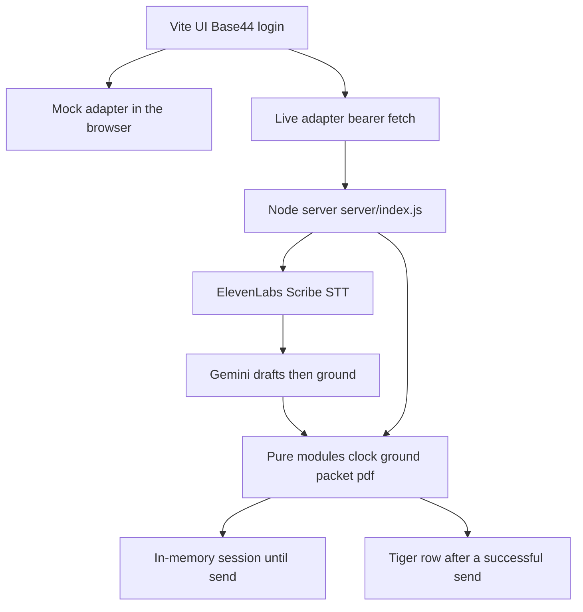
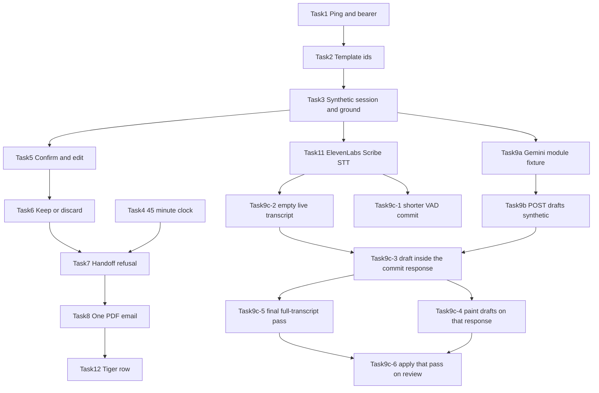

# Implementation Plan: Backend for the clinical intake workspace

## Overview

The Vite app in this repo is the UI. Live mode already refuses to guess routes: [`src/api/endpoints.js`](../src/api/endpoints.js) and [`src/api/liveWorkspace.js`](../src/api/liveWorkspace.js) leave every path `null`, and [`src/api/config.js`](../src/api/config.js) stores a backend base URL plus a bearer token. This plan adds that Node server and the clinical rules behind the workspace calls the screens already make.

Send is allowed only when **both** of these are true, plus the field checks the review screen already assumes:

- Server-computed elapsed time is at least 45:00. Earlier than that, send is refused. There is no expiration that blocks send after 45:00.
- The clinician has chosen what happens to the form. **Send** is `POST .../handoff`. **Keep** and **Discard** never email, at any clock time.

This revision replaces the unfinished Next.js plan. Product code starts with `/build`, not here.

## Architecture decisions

- **UI stays Vite.** Base44 login, register, and the marketing pages stay as they are. The clinical server does not reimplement accounts.
- **Rules stay out of React.** Pages already display answers and refusal reasons. They do not decide the gate. New logic lives in plain Node ESM under `server/`, tested with `node --test`.
- **One process, no new framework.** `node:http` plus a route table. CORS for the Vite origin. `Authorization: Bearer` must match `BACKEND_TOKEN`.
- **Session memory, then Tiger.** Unsent drafts live in process memory. A successful send inserts one Tiger row: case id, therapist email, PDF bytes, `sent_at`, nudge ids. No raw audio and no full transcript. Missing `DATABASE_URL` skips the insert; download bytes and the email already succeeded.
- **The server does not trust the client clock or the client’s confirmed-id list.** `createSession` stores `startedAt`. The handoff route reads `Date.now()` once at the boundary and passes both numbers into `clockStatus(startedAt, now)`. The clock module itself never calls `Date.now()`. Handoff uses answers stored by `recordClinicianAction`. A client that posts every field id still fails if the server never recorded those confirms.
- **Canonical questions match the UI copy** in [`src/api/templates/adultIntake.js`](../src/api/templates/adultIntake.js): `adult-intake-v1`, required ids, and safety on `PHQ-009`, `SAF-001`, `SAF-002`. One emailed PDF contains those confirmed fields. PHQ-9 is not a second attachment. The code template is 4 pages; do not invent the other pages.
- **Demo clock shortcut:** with `ALLOW_DEMO_OFFSET=1`, creating the synthetic session may set `startedAt` 45 minutes in the past so a judge can see an allowed send. Unset, the gate uses real elapsed time. `shortcut: demo offset is env-gated and off by default.`
- **Transcript comes from ElevenLabs Scribe, not TTS.** Live audio is speech-to-text. There is no “play question” speech endpoint. Gemini only sees transcript text, then `ground` keeps or drops drafts. Demo mode keeps the synthetic fixture. A live session does not.
- **Task 9c uses Task 11’s committed lines. It does not wait for Task 10.** `POST .../transcript-lines` already appends `{ t, speaker, text }`. There is no second normalizer and no full-transcript file. Partials stay on the video overlay. They are not posted and they are not drafted: a partial is not a quote `ground` can keep.
- **Lowest latency on the path that already exists.** Audio stays browser → ElevenLabs. The Node process never sees PCM. After a commit, one `POST .../transcript-lines` stores the line and returns grounded drafts in that same response. The form paints from that body. No poll, no SSE, no second `POST .../drafts`. At most one Gemini call is in flight per session; a commit that arrives mid-call is stored immediately and one follow-up runs when the current call finishes. The response carries `seq` (how many live lines that draft saw). The client applies a response only when `seq` is at least the last one applied, so a late first response cannot wipe a newer draft. Live `createSession` (`live: true`) starts with an empty transcript, so the fixture ramble is not in the prompt and not on the form. The Gemini call stays `gemini-2.5-flash` with `thinkingBudget: 0` (2.5 Flash thinks dynamically unless this is set) and only questions not already confirmed. `shortcut: vad_silence_threshold_secs=0.4`. The API accepts above 0.3 through 3.0; the default 1.5s is the long pause before a commit. 0.4s can split one sentence across lines; each draft still sees every live line, and `ground` already allows `...` between quote parts.
- **One final Gemini pass, off the commit path.** When the clinician opens review, `POST .../drafts` with `{ pass: "final" }` sends the server’s full live transcript, the questions that are not confirmed, and the current non-confirmed drafts as context. One `gemini-2.5-flash` `generateContent` call. No tool loop and no second model. `shortcut: thinkingBudget=1024` on this call only; the commit call stays at 0. The model may fill a blank or replace a draft. A field it omits stays as it was. `ground` still drops invented quotes. Confirmed answers are left out of the prompt and dropped if the model returns them. An empty transcript returns `drafts: []` and does not call Gemini. `POST .../drafts` without `pass: "final"` stays the synthetic recorded-body path.
- **No diagnosis codes.** Gemini prompts must not ask for a diagnosis code. Real (non-synthetic) transcript bodies need `ALLOW_PHI=1`.

## Route contract

Fill these in the live adapter only in the task that implements the handler.

- `GET /api/ping` → `{ ok: true }`
- `GET /api/templates` and `GET /api/templates/:templateId`
- `POST /api/sessions` → the shape `Workspace.jsx` already stores (`id`, `patientLabel`, `therapist`, `plannedMinutes: 45`, `templateId`, `startedAt`). `{ live: true }` starts with `transcript: []` and `events: []`. Without that flag the session still copies the synthetic fixture.
- `GET /api/sessions/:sessionId/transcript` → `{ t, speaker, text }[]`
- `GET /api/sessions/:sessionId/events` → `{ at, fieldId, status, answer, evidence, t }[]`
- `POST /api/sessions/:sessionId/drafts` → without `pass: "final"`, synthetic sessions only: recorded Gemini body, then `ground`. With `{ pass: "final", drafts }` on a live session: one full-transcript pass, then `ground`. Response `{ drafts }`. Omitted fields are not clears.
- `POST /api/sessions/:sessionId/actions` → `{ ok: true }`
- `POST /api/sessions/:sessionId/retain` → `{ ok: true, status: "draft_retained", sent: false }`
- `POST /api/sessions/:sessionId/discard` → `{ ok: true }`
- `POST /api/sessions/:sessionId/handoff` → `{ allowed: true, sent: true, to }` or `{ allowed: false, reasons: [{ code, message }] }` with HTTP 200
- `POST /api/stt/token` → `{ token, wsUrl }` single-use ElevenLabs realtime STT token
- `POST /api/sessions/:sessionId/transcript-lines` → append `{ t, speaker, text }` from a committed STT line. On a live session the same response is `{ t, speaker, text, seq, drafts }` (or `drafts: []` plus `code` when PHI is off or Gemini fails). The line is stored either way.

Refusal reasons the review alert already prints verbatim: `REQUIRED_UNCONFIRMED`, `SAFETY_UNRESOLVED`, `NO_RECIPIENT`, `SEND_GATE_NOT_MET`. Auth and missing session stay 401 and 404 with `{ message, code }`. There is no `/play` route.

## Dependency graph

Ping and the template ids come first. After that, the clock and Scribe/Gemini branches can proceed separately from confirm/keep. Do not share `package.json` edits across open branches.

**Current slice:** 9c-1 through 9c-6. Task 11 is done. Task 10 is not on this path.

**Parallel note:** 9c-1 (WebSocket URL and PCM) and 9c-2 (empty live transcript) do not depend on each other. 9c-3 needs 9c-2 and 9b. 9c-4 needs 9c-3. 9c-5 needs 9c-3 and can run beside 9c-4. 9c-6 needs 9c-4 and 9c-5. Tasks 4 and 6–8 and 12 stay open and are not this slice.

## Task list

### Phase 1: Server the UI can reach

- [x] Task 1: Ping, CORS, bearer
- [x] Task 2: Canonical adult-intake template
- [x] Task 3: Synthetic session, transcript, grounded events

### Checkpoint: After Tasks 1–3

- [x] `node --test` passes
- [x] Live mode can ping, load the template, and create a session whose events match the fixture
- [ ] Human review before the next phase

### Phase 2: Clock and the clinician’s choice

- [ ] Task 4: 45:00 minimum clock
- [x] Task 5: Confirm and edit
- [ ] Task 6: Keep or discard

### Checkpoint: After Tasks 4–6

- [ ] `node --test` passes
- [ ] Under 45:00, keep and discard email nothing
- [ ] A waived safety item is not confirmed
- [ ] Human review before the next phase

### Phase 3: Send

- [ ] Task 7: Handoff refusal
- [ ] Task 8: One PDF, one email, and the mock gate

### Checkpoint: After Tasks 7–8

- [ ] `node --test` passes and `npm run build` succeeds
- [ ] Live handoff shows refusal reasons in the review dialog, then one send at or after 45:00
- [ ] Human review before sponsor integrations

### Phase 4a: Gemini drafts without live STT (after Task 3; no Task 11)

Use Task 3’s synthetic `{ t, speaker, text }[]` as the only transcript source. Stub Gemini HTTP with a recorded JSON body. Do not call ElevenLabs. Do not wait for Task 10.

- [x] Task 9a: Gemini module, recorded response, ground, PHI + no-diagnosis checks
- [x] Task 9b: `POST /api/sessions/:sessionId/drafts` on the synthetic session transcript

### Checkpoint: After Tasks 9a–9b

- [x] `node --test server/test/gemini.test.js` passes
- [x] Invented quotes fill nothing; request text has no diagnosis-code instruction
- [x] Live (or curl) createSession → POST drafts → grounded events from the synthetic transcript
- [ ] Human review before treating Scribe as the transcript source

### Phase 4b: Drafts from Task 11 commits (current slice)

Task 10 is not a step here. Task 11 already commits `{ t, speaker, text }`.

- [x] Task 11: ElevenLabs Scribe real-time STT (token mint + browser mic; see `server/stt.js`)
- [x] Task 9c-1: Shorter VAD commit, 16 kHz PCM
- [x] Task 9c-2: Live session transcript starts empty
- [x] Task 9c-3: Commit response includes grounded drafts
- [x] Task 9c-4: Form paints those drafts immediately
- [ ] Task 9c-5: Final Gemini pass over the full transcript
- [ ] Task 9c-6: Review applies that pass without clearing omissions

### Checkpoint: After Tasks 9c-1 and 9c-2

- [x] `npm run test:stt` and `node --test server/test/session.test.js` pass
- [x] A live session’s transcript is only appended lines; a non-live session is still the fixture
- [ ] Human review before Gemini runs on live lines

### Checkpoint: After Tasks 9c-3 and 9c-4

- [x] `node --test server/test/gemini.test.js` passes, including the synthetic `POST /drafts` case with no network
- [x] One committed line returns grounded drafts in that response; a second commit during the call does not run two Gemini requests at once
- [x] The form shows the new draft when the commit response arrives, and a confirmed field stays confirmed
- [ ] Human approval before a live microphone with `ALLOW_PHI=1`

### Checkpoint: After Tasks 9c-5 and 9c-6

- [ ] `node --test server/test/gemini.test.js` passes, including synthetic `POST /drafts` with no `pass` and no network
- [ ] A final pass fills a blank and replaces a draft; an omitted field and a confirmed field stay as they were
- [ ] Opening review does not call Gemini again when no new line was committed
- [ ] Human approval before a live microphone with `ALLOW_PHI=1`

### Later, not this slice

- [ ] Task 10: Full Scribe transcript file (not required for 9c)
- [ ] Task 12: Tiger stores the sent packet

### Checkpoint: Demo

- [ ] `node --test` passes
- [ ] Synthetic path: fixture transcript → grounded Gemini drafts, keep and discard send nothing, send is refused before 45:00, one PDF email at or after 45:00, no second email
- [ ] Live path: mic commit → one `POST .../transcript-lines` → grounded drafts on the form. Opening review runs one full-transcript pass that fills or updates unconfirmed answers. Task 10 is not required.
- [ ] Tiger row only when `DATABASE_URL` is set
- [ ] Human approval before a live microphone, real Scribe session, or a real inbox

## Risks and mitigations

| Risk | Impact | Mitigation |
|---|---|---|
| Mock blocks send after 45:00 | High | Task 8 flips that check to `SEND_GATE_NOT_MET` when under 45:00 |
| Client lies about elapsed or confirmed ids | High | Server ignores both; uses `startedAt` and stored actions |
| Gemini invents quotes or diagnoses | High | `ground` drops invented quotes; prompt forbids diagnosis codes |
| Live mic / Scribe without consent | High | Stub in tests; live STT only with key + human approval; `ALLOW_PHI` for non-synthetic. A missing flag still stores the line and returns `drafts: []`. |
| Drafts wait on a second hop or on partials | High | Draft only on VAD commit, inside that POST. Partials stay local. |
| 0.4s VAD splits a sentence | Med | Each draft sees every live line. `ground` accepts `...` between quote parts. Do not drop the threshold below 0.4. |
| Late Gemini response overwrites a newer draft | Med | `seq` on the response; client applies only `seq` ≥ last applied |
| Fixture ramble mixed into a live prompt | High | `live: true` starts with an empty transcript. Non-live create is unchanged. |
| Final pass wipes a good draft or a confirm | High | Omitted fields stay. Confirmed ids never enter the prompt and are dropped from the result. The pass does not run inside `transcript-lines`. |
| Final pass thinks for a long time | Med | `thinkingBudget` 1024 on that call only. Review opens with the drafts already on the form. |
| No PSY scan in the repo | Med | pdf-lib document of the confirmed packet; UI template is 4 pages |
| Dashboard says PDFKit | Low | Server uses `pdf-lib`; label can stay |
| Demo needs a send without waiting | Med | `ALLOW_DEMO_OFFSET=1` only; off by default |
| SMTP or Tiger unset at the demo | Med | Fake mailer and PDF buffer still prove send |
| Base44 auth ≠ bearer token | Med | Connection settings still require the token |

## Out of scope

- Next.js, a Base44 clinical database, Convex, and the unwired clinic CRUD (`listPatients`, `generateReport`, dashboard stats)
- Presage SDK and camera frames
- ElevenLabs text-to-speech / “play question” audio
- Task 10’s full-transcript file, a `/transcript/chunks` partials route, SSE, and proxying PCM through Node
- Drafting on `partial_transcript`, AudioWorklet, a second Gemini model, and speaker diarization (the mic is one stream labeled Clinician)
- A packaged Zoom app, Zoom timeline import, GoDaddy API, Solana, Snowflake
- Production HIPAA, real PHI without `ALLOW_PHI`, diagnosis codes, DSM criterion text
- A second emailed PHQ-9, send before 45:00, and a second email for the same session

## Definition of done

Each task’s acceptance criteria sit on top of `.cursor/references/definition-of-done.md`. A task is done when its criteria pass and the Correctness and Quality bars in that file are met. Human review is required before the next phase.
