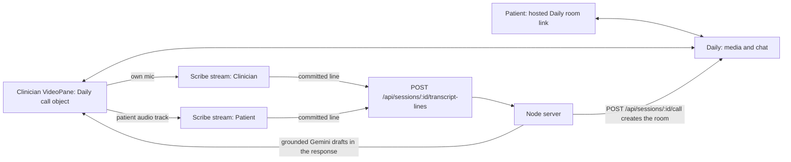

# Live video call plan: Daily call plus ElevenLabs transcription

Tasks 13–15 in `tasks/todo.md` implement this. Synthetic role-play only. No real patient data.

## Requirements

- A real two-party browser call: the clinician in the workspace, the patient on a phone or laptop.
- Real in-call chat.
- The patient joins through a provider-hosted link. We build no patient page.
- Live transcription of **both** voices feeds the existing Gemini draft path.
- $0 and no card on file.

## Already in the tree (do not rebuild)

- Task 11: `VideoPane` mints a single-use ElevenLabs token (`POST /api/stt/token`), and `src/lib/realtimeStt.js` streams the clinician's microphone to `scribe_v2_realtime`. Committed lines post to `POST /api/sessions/:sessionId/transcript-lines`.
- Task 9c: each committed line on a live session returns grounded Gemini drafts in the same response. Opening review runs one final pass over the stored transcript.
- `POST /api/sessions` with `live: true` starts an empty transcript. That stays the meaning of `live`; video is a separate route.

## The gap

`startRealtimeStt` captures only the local microphone, and every committed line is labeled `speaker: "Clinician"`. In a real call, the patient's voice arrives over the network. It is never transcribed, so Gemini has no patient answers to draft from.

## Decision: Daily, call-object mode on the clinician side

| Option | Why / why not |
| --- | --- |
| **Daily** (chosen) | Free video and chat (10,000 participant-minutes/month, no card). The hosted room URL is the patient link, with a prejoin check, knock-to-enter, and chat. Call-object mode hands our page the patient's raw audio track (`participants()[id].tracks.audio.persistentTrack`), which is what Scribe needs. |
| Stream | Captions would come from the free credit, but there is no hosted join link: we would build a patient page and a public token endpoint. |
| ZEGOCLOUD | No hosted join link. Speech-to-text needs a separate trial application. |

Not used: Daily's own transcription (paid plan only) and Chrome's speech recognition. ElevenLabs is the transcription engine.

## Data flow

## Free-tier budget

- Daily: video and chat on the free tier.
- ElevenLabs free plan: 2.5 hours of realtime Scribe per month, 6 concurrent streams. Two streams per call means about 75 minutes of two-person calls per account per month. Rehearse on the synthetic path; keep live runs short.
- Gemini: free tier, as today.

## Risks

- **Echo:** the clinician wears headphones, or the patient's voice from the laptop speakers is also transcribed as "Clinician".
- **Chrome quirk:** remote call audio only reaches Web Audio while it is also playing in a media element. Keep the patient's `<audio>` element mounted.
- **Borrowed track:** `startRealtimeStt`'s `stop()` must never stop a track it did not open. Stopping Daily's track would mute the patient in the call.
- **Gemini rate limits:** two streams roughly double committed lines. The existing queue keeps one call in flight; a failure returns `drafts: []` with a code, and the final pass on review covers the gap.
- **Hosted-page chat format:** `{ event: "chat-msg", message, name }` comes from third-party docs. Check it in the first 30 minutes of Task 14.
- **Data:** live drafts need `ALLOW_PHI=1`. Audio goes to Daily and ElevenLabs; text goes to Gemini. Synthetic script only, with the visible banner.

## Hard stop

If Task 14 is not working by the halfway point, demo mic-only live mode (which works today) plus the synthetic path, and describe the call as in progress.

## Not doing

Recording, screen share, our own patient join page, deleting Daily rooms on discard (rooms expire after two hours), and speaker diarization (each stream is one speaker).
